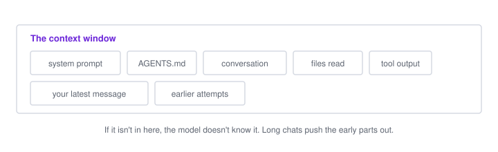

# How AI works (enough to use it well)

You don't need the maths. You need a rough picture of what's going on, because almost every prompting tip follows from it.

## A language model predicts text

Tools like Claude, ChatGPT and Gemini are built on **large language models** (LLMs). At heart, an LLM does one thing: given some text, it predicts what text comes next, one small piece at a time.

```
"The capital of France is"  →  " Paris"
```

It gets good at this by **training** on an enormous amount of text: books, websites, code, documentation. To predict the next word of a Python tutorial well, it has to pick up how Python works. To predict the next line of a bug fix, it has to pick up how bugs get fixed. That's where the apparent knowledge and reasoning come from.

After that, models get further training to follow instructions, hold a conversation, refuse harmful requests and use tools. That's what turns "predicts text" into "assistant".

**What this means for you:** the model produces the most plausible continuation of what it's been given. A vague prompt gets a plausible, generic answer. A specific prompt with real details gets a specific answer.

## Tokens

Models don't read words; they read **tokens**, chunks of text that are often a word or part of a word. In English, a token averages about three-quarters of a word. Code and other languages often use more tokens per word.

```
"unbelievable"  →  "un" "believ" "able"   (roughly)
```

Tokens matter because they're the unit for both limits and cost. API pricing is per million tokens, and subscription plans have usage limits measured the same way.

## The context window: its whole world

The model can only "see" a fixed amount of text at once, called the **context window**. Everything it knows about your situation has to be inside it:

- the system instructions from the tool
- your instruction files (`CLAUDE.md`, `AGENTS.md`)
- the whole conversation so far
- files it has read, command output, errors you pasted


*Everything the model can see is in one box. A long session fills the box and the earliest parts drop out.*

Modern windows are large (often hundreds of thousands of tokens), but they fill up, especially when an agent reads lots of files.

**What this means for you:**

- **It only knows what's in the window.** If you didn't tell it, and it didn't read it, it doesn't know it. Hence: give context.
- **Long conversations get worse.** As the window fills with old attempts and dead ends, answers get less focused. Tools may "compact" (summarise) old messages, which loses detail. Start a new chat for a new task.
- **Paste what matters, not everything.** The relevant file and the full error beat your whole codebase.

## It has no memory between chats

Each new conversation starts blank. The model doesn't remember yesterday's chat, your project or your preferences, unless the tool puts that information back into the context window. That's exactly what instruction files and memory features do: they're text that gets loaded at the start.

**What this means for you:** if something should always be known (your stack, your rules), put it in an [instruction file](instruction-files.md). Don't rely on "I told it last time".

## Its knowledge has a cutoff

Training stops at some date. The model doesn't know about library versions, APIs or events after that, and it may confidently use an old way of doing things.

**What this means for you:** for anything that changes fast (framework versions, API details, prices), give it the current docs or let it search. If code uses a function that "doesn't exist", an outdated API is a likely cause.

## It can be confidently wrong

Because it generates plausible text, it sometimes produces things that look right and aren't: a function that doesn't exist, a package name it invented, a citation that isn't real. This is called **hallucination**. It doesn't "know" it's wrong; plausible and true just usually overlap.

**What this means for you:**

- Run the code. Test the fix. Click the button.
- Be suspicious of package names you've never heard of; check they exist before installing (fake package names are a known security risk).
- Ask "how sure are you?" or "how can I check this?" for anything important.

## It's not the same every time

There's some randomness in how the next token is chosen, so the same prompt can give different answers. That's useful (regenerate for alternatives) and occasionally annoying (a fix that worked once may come out differently next time).

## Thinking

Many models can "think" before answering: they generate a hidden or visible chain of reasoning first, then the answer. This helps with debugging, planning and maths, at the cost of time and tokens. Many tools let you choose the model or a thinking level; use more for hard problems and less for simple edits.

## Chat vs agent

A **chat** model reads your message and writes a reply. That's it. It can't see your files or run anything; you copy things in and out.

An **agent** is a model plus **tools**, running in a loop:

```
you: "fix the failing test"
  │
  ▼
model decides: read the test file      → tool reads it, result goes into context
model decides: run the tests           → tool runs them, output goes into context
model decides: edit src/upload.ts      → tool edits it (after you approve)
model decides: run the tests again     → they pass
model: "Fixed. The bug was …"
```

Every tool result goes back into the context window, and the model decides the next step from there. This is how Claude Code, Codex, Copilot's agent mode and similar tools work.

**What this means for you:**

- Agents can get information themselves, so you can say "look at how the other API routes do it" instead of pasting them.
- They can also do a lot quickly, including the wrong thing. Commit before you start, and read the diff.
- Tool output fills the context window too, which is another reason long sessions degrade.

## Models differ

Different models (and sizes of the same model) trade off speed, cost and capability. A big model is better at hard reasoning and large changes; a small fast one is fine for renaming things or writing boilerplate. If your tool lets you choose, match the model to the task.

## The short version

| Fact | So… |
| --- | --- |
| It predicts plausible text | Be specific; vague in, generic out |
| It only sees the context window | Give it the relevant files, errors and goals |
| It forgets between chats | Put lasting info in instruction files |
| Long chats degrade | New task, new chat |
| Its knowledge is dated | Give it current docs for fast-moving tools |
| It can be confidently wrong | Run and test everything |
| Agents act through tools | Commit first, review the diff |
