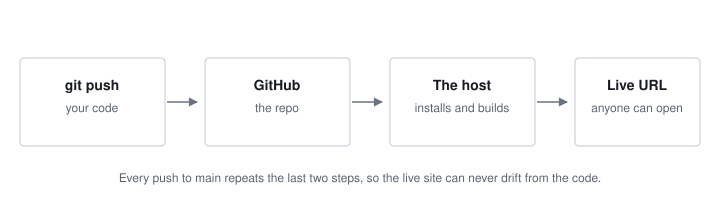

# Deploying

**Deploying** means putting your app on a server that's always online, so anyone can open it with a link. Until then, it only exists on your `localhost`, which nobody else can reach.

Deploy in the first hour of the hackathon, even if the page is empty. Problems are much easier to fix with an empty app than with a finished one at 3am.

## What a host does

*You push; the host notices, installs, builds and publishes. Nobody copies files onto a server by hand.*

Connect your GitHub repo once, and every push to `main` deploys automatically. Most hosts also make a **preview URL** for every branch or pull request, so you can test a change before merging.

## Types of hosting

| Type | What it runs | Good for | Hosts (free tiers) |
| --- | --- | --- | --- |
| **Static** | HTML, CSS, JS files only | Sites with no backend (rain-check) | GitHub Pages, Netlify, Cloudflare Pages, Vercel |
| **Serverless** | Static files + small backend functions | Next.js and most hackathon apps | Vercel, Netlify, Cloudflare |
| **Server / container** | A program that keeps running | Python backends, websockets, long jobs, Docker | Render, Railway, Fly.io |
| **App platforms** | One specific kind of app | Streamlit, Expo | Streamlit Community Cloud, Expo |

Free tiers on server hosts often "sleep" when unused, so the first request after a while takes 30 seconds or more. Open your app a minute before you present.

## Deploying, step by step (Vercel)

For a Next.js, React or plain static project:

1. Push your project to GitHub.
2. Go to [vercel.com](https://vercel.com), sign in with GitHub, click **Add New → Project**, and pick your repo.
3. Vercel detects the framework. Leave the settings unless you know they're wrong.
4. Add your **environment variables** (everything in `.env.example`, with the real values).
5. Click **Deploy**. In a minute or two you get a URL like `your-app.vercel.app`.

Or from the terminal, in the project folder: `npx vercel`.

Netlify and Cloudflare Pages work the same way. For a Python backend on Render: New → Web Service → pick the repo → set the start command (e.g. `uvicorn main:app --host 0.0.0.0 --port $PORT`) and environment variables.

GitHub Pages (static sites only): repo → Settings → Pages → choose the branch. That's how rain-check and this booklet are hosted.

## When the deploy fails

Open the deploy's **build logs** in the host's dashboard and read from the first error. The usual causes:

1. **The build fails.** Run `npm run build` locally; fix whatever it says.
2. **Missing environment variables.** The host doesn't have your `.env`. Add them in its settings, then redeploy.
3. **File name case.** Your Mac or Windows laptop treats `Button.tsx` and `button.tsx` as the same file; the Linux server doesn't.
4. **Wrong Node or Python version.** Set it in the host's settings.
5. **It deploys but the page errors.** Open the browser console (`F12`) and the host's **runtime logs** (Vercel: the project's Logs tab).

More in [troubleshooting](../setup/troubleshooting.md#works-locally-fails-when-deployed).

## Rolling back

Hosts keep every deploy. If the latest one is broken and you're about to present, open the list of deployments and promote or redeploy the last working one. It takes seconds.

## Custom domains

`recipe-snap.vercel.app` is fine for a hackathon. If you want `recipesnap.app`, buy the domain (students can get one free through the [GitHub Student Pack](../resources/free-stuff.md)) and add it in the host's domain settings. Do it early; DNS changes can take time to work.

## Before you present

- Open the live URL in a private window and on your phone.
- Click through the whole demo on the live site, not just localhost.
- Wake up any sleeping backends.
- Keep the last working deploy in mind in case you need to roll back.
