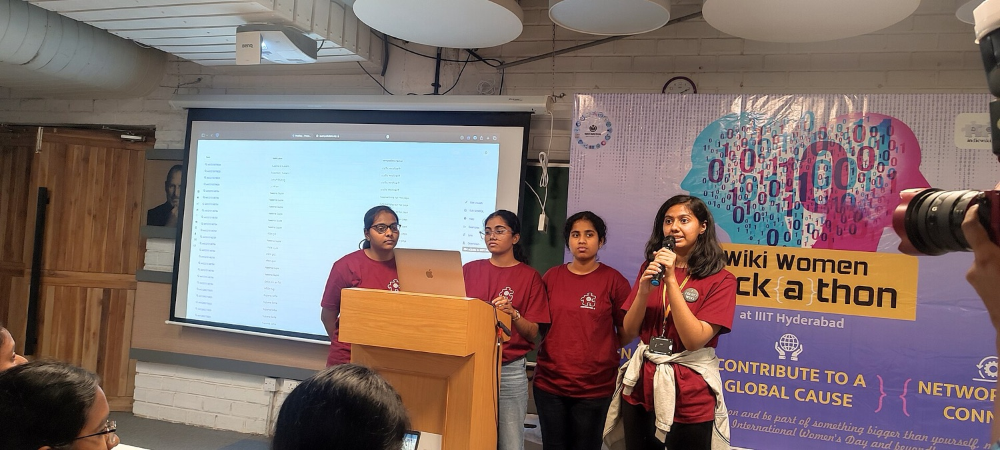
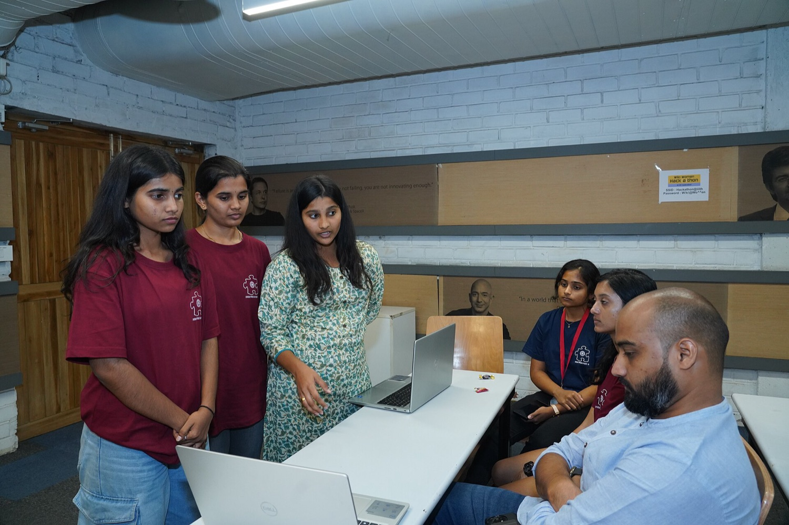

# Presenting

Judging happens in one of two ways, and the event page or the organisers will say which:

- **Stage pitches.** Each team presents to the judges, often in front of everyone, with a strict time limit.
- **Table judging** (also called an expo or science fair). Teams stay at their tables and judges walk round, spending a few minutes at each.

Some events do both: table judging first, then the best teams pitch on stage.

## Who does what

Decide before the last day.

- **One or two speakers.** Handing over between four people wastes time and sounds messy. Pick whoever is most comfortable talking, not necessarily whoever wrote the most code.
- **One driver** at the laptop who runs the demo while the speaker talks. If the speaker also drives, they end up looking at the screen instead of the judges.
- **Everyone else** stands with the team and helps with questions about the parts they built.

*One person speaks, one runs the laptop. Wiki Women Hackathon 2024, IIIT Hyderabad. Photo: Kasyap, CC BY-SA 4.0.*

Each person should be able to explain the whole project in a sentence or two, in case someone's away when a judge comes past.

## Timing

Time limits are usually enforced; some events cut the microphone. If you have three minutes, plan for two and a half.

When practising, the first run is almost always too long. Cut from the introduction and the "how it works" part, not from the demo.

Don't spend time introducing the team at the start. Names are on the title slide.

## On stage

- Stand where the judges can see you and the screen.
- Look at the judges, not at the slides. Glance at the screen only to check where you are.
- If there's a microphone, hold it close and keep it there. People tend to drift it away from their mouth.
- Speak slower than feels natural. Most people speed up when they're nervous.
- Say the project name early, and once at the end.
- When you finish, stop and say "thanks". Don't trail off into "so yeah, that's it".

## Questions

Questions are part of the score at most events. Common ones:

- How is this different from what already exists?
- What was the hardest part technically?
- What's real and what's mocked?
- Did you use AI, and for what?
- Who would pay for it, or use it?
- What would you do with another month?

Agree beforehand who answers which kind of question. Keep answers short, and if you don't know, say so: "We didn't get to that; we'd do it by…" is better than guessing.

If a judge points out a weakness, agree with the part that's true and say what you'd do about it, instead of arguing.

## Table judging

At a table, judges arrive in the middle of whatever you're doing, often with only a few minutes.

*Table judging at the Wiki Women Hackathon 2024, IIIT Hyderabad. Photo: Kasyap, CC BY 4.0.*

- Have a **30-second version** of the pitch ready: the problem, then straight into the demo.
- Keep the app **open on the main screen**, reset and ready to start.
- Turn the laptop or a second screen to face where people walk past. A printed sign with the project name and table number helps judges find you.
- Someone should be at the table at all times during judging, even if the others go to look at other projects.
- Judges may come back with follow-up questions. Write down what they asked; it often tells you what the next judge will ask.

## Online judging

On a video call:

- Share **one window**, not your whole screen, so notifications and other tabs stay hidden.
- Test screen sharing with the call software before your slot. On a Mac, the browser or call app needs screen recording permission (System Settings → Privacy & Security → Screen & System Audio Recording), and you have to restart the app after granting it.
- Use earphones to avoid echo, and mute when you're not speaking.
- Have the demo video ready to share if the live app won't load.

## After you present

Stop pushing changes to the deployed app until judging is over. Judges may open your link later, and it should be the version you showed.

Next: [Sponsors](sponsors.md).
