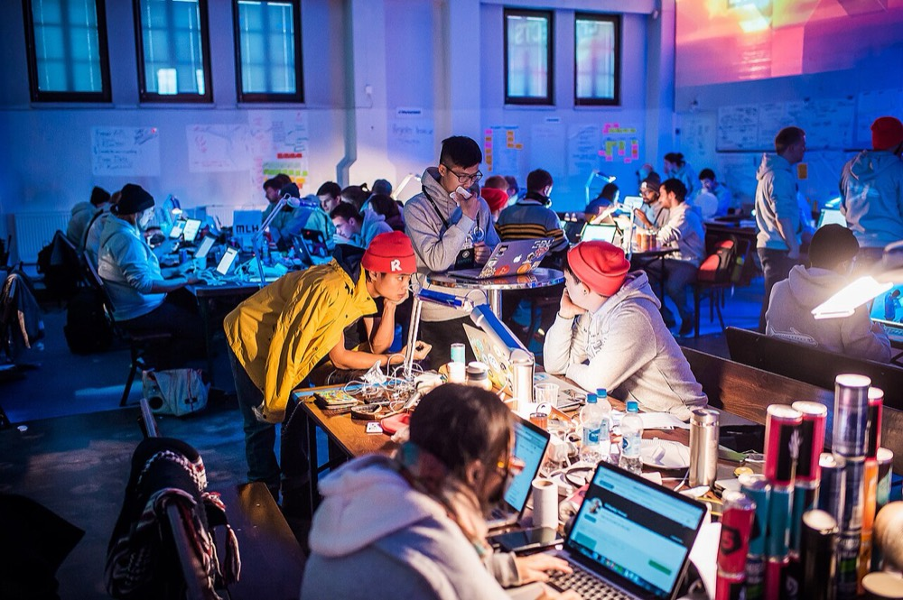
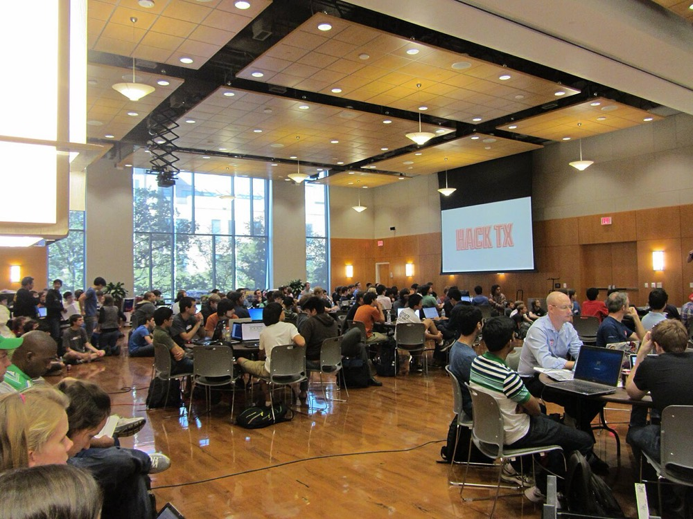
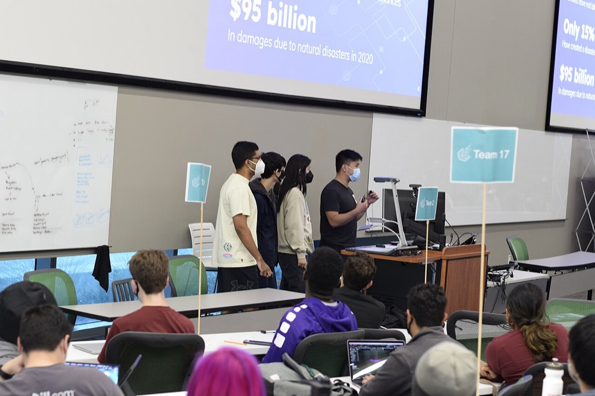
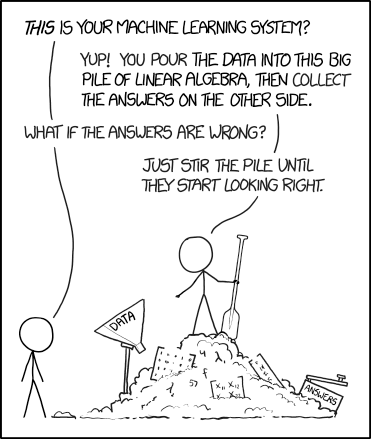
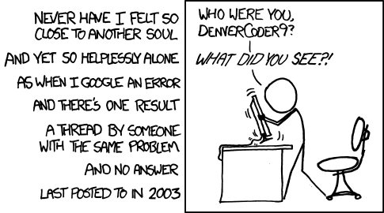
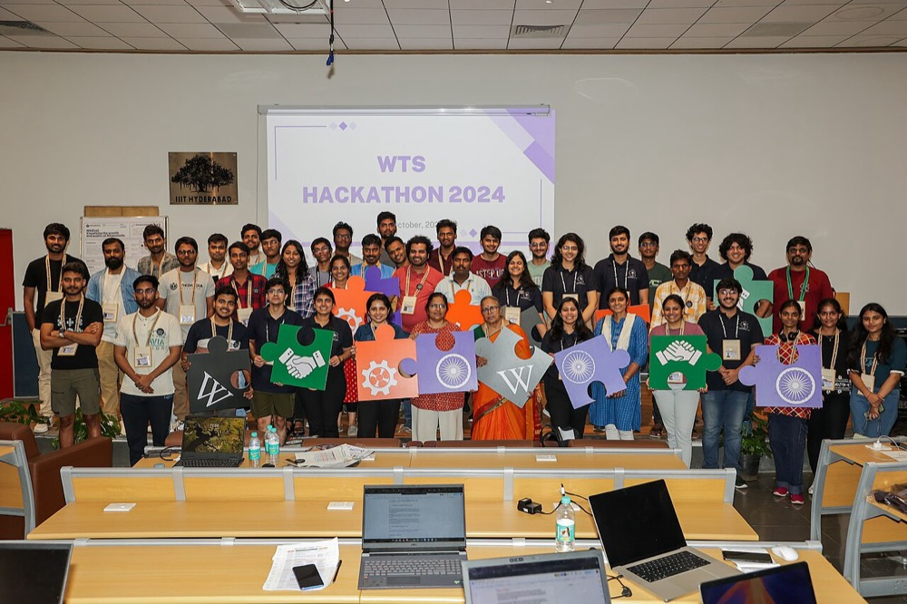

# What is a hackathon?

A hackathon is an event where people form small teams and build something, usually an app or website, in a fixed amount of time, often 24 to 48 hours. At the end, every team shows what they made and judges pick the winners.

"Hack" here means building something quickly. It isn't about breaking into computers.

*Junction 2015, Helsinki.*

## What happens

Most hackathons follow the same pattern:

1. **Opening.** The organisers explain the rules, the theme, the prizes and the deadline. Sponsors (companies supporting the event) often give short talks.
2. **Forming teams.** Teams are usually 2 to 4 people. If you come alone, there's normally a session for finding a team, and plenty of people come alone.
3. **Building.** This is most of the event. Mentors walk around to help when you're stuck, there are often workshops, and food is usually provided. Some people sleep at the venue.
4. **Submitting.** Before the deadline, each team hands in a link to their code, a short description, and sometimes a video.
5. **Demos and judging.** Each team gets a few minutes to show their project to the judges.
6. **Closing.** Winners are announced.

*Opening of HackTX 2012, University of Texas.*

*A team presenting at HackUTD VIII.*

## Who goes

Mostly students, from every year and every course, not only computer science. A team needs more than coders: someone who designs the screens, someone who understands the problem, someone who's good at presenting. At any hackathon, lots of people are there for the first time.

## Do I need to be good at coding?

No. If you can follow a tutorial and aren't afraid to ask questions, you can contribute. Many hackathons have beginner tracks or a prize for the best first-time team.

*At a hackathon, a working demo matters more than tidy code.*

## What it costs, and what you get

Most student hackathons are **free**, and food is usually included. Some even help with travel.

What you leave with:

- A project you can put on your CV or GitHub
- New friends, and contacts at companies (sponsors are often there to hire)
- Free stuff: t-shirts, stickers, sometimes hardware, usually called "swag"
- Sometimes a prize

## Kinds of hackathons

- **In person or online.** In person is more fun and easier to get help at. Online is easier to fit around other things.
- **Open or themed.** Some let you build anything; others have a theme such as health, sustainability or education.
- **Tracks and sponsor prizes.** Many events have several categories to enter, like "best use of a particular company's API". You can often enter more than one.
- **Beginner-friendly events.** Look for "beginner" or "first-timer" in the description.

To find events, look at [MLH](https://mlh.io/seasons/2027/events) and [Devpost](https://devpost.com/hackathons), and ask your university's computing club, which often runs or advertises them.

## How AI has changed hackathons

A few years ago, most of a team's time went into writing code by hand. Now most teams use AI coding agents such as Claude Code, Codex, Copilot or Cursor, and that has changed several things:

- **More gets built.** An agent can write a login page, a database setup or a whole screen in minutes. A small team can now finish in a weekend what used to take a week.
- **Judges expect more.** Since everyone builds faster, a basic working app stands out less. Polish, a clear demo and a real problem matter more.
- **Many projects use AI inside them.** Plenty of teams build on top of a language model API. Because "an app that sends text to a chatbot" is now common, judges look for what your project does beyond that.
- **Beginners can contribute more.** If you can describe clearly what you want and check the result, an agent can help you build parts you couldn't have written alone.
- **The skills that matter have shifted.** Less typing; more deciding what to build, splitting up the work, reading and testing what the agent wrote, and explaining it in the demo.
- **Understanding still counts.** Judges often ask how something works. "The AI wrote it" isn't a good answer, so read the code your agent produces.
- **Rules vary.** Most events allow AI tools, some ask you to say how you used them, and a few restrict them. Check the rules page before you start.

*AI output can look right without being right. Test it before you rely on it.*

Setting up an agent is covered in [AI coding agents](setup/ai-agents.md), and using one during the event in [AI tools](guide/05-ai-tools.md).

## Words you'll hear

- **Track**: a category of the competition, each with its own prize
- **Sponsor**: a company that supports the event, often offering its own prize and mentors
- **Mentor**: an experienced person there to help teams when they're stuck
- **Devpost**: the website many hackathons use for submissions
- **MVP** (minimum viable product): the smallest version of your idea that still works
- **Demo / pitch**: showing your project and explaining why it matters

There are more in the [glossary](resources/glossary.md).

## Common problems

Things will break and the cause won't always be obvious. Git is a common source of trouble; see [Git with a team](guide/04-git-with-a-team.md).

Searching an error message sometimes turns up nothing useful. Ask a mentor when that happens.

Expect to be tired, for the Wi-Fi to be slow, and for something to break near the demo. Leave time for it.

*WTS Hackathon 2024, IIIT Hyderabad.*

## Next

Get your laptop ready with [Start here](setup/start-here.md), learn the basics in [How apps work](basics/) and [Git and GitHub](git/), then read [the guide](guide/README.md), which takes you from the week before the event to the demo.

## Image credits

Photographers, licences and links to the originals for every picture on the site are in [Image credits](credits.md). Photos were resized for the web.
